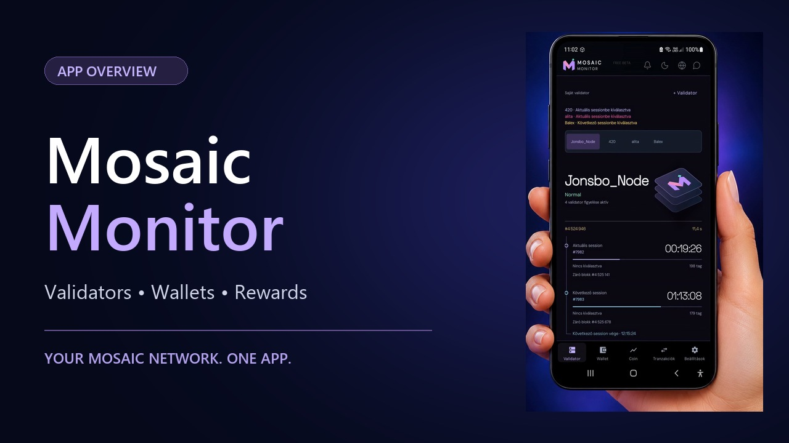
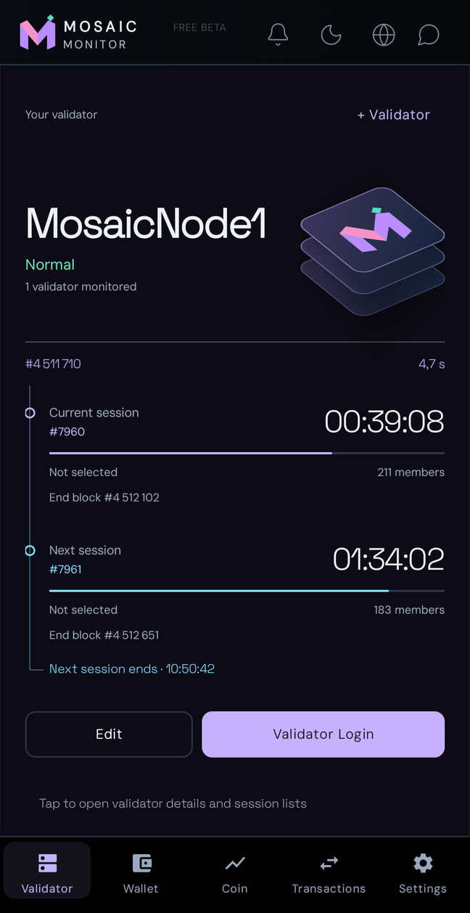
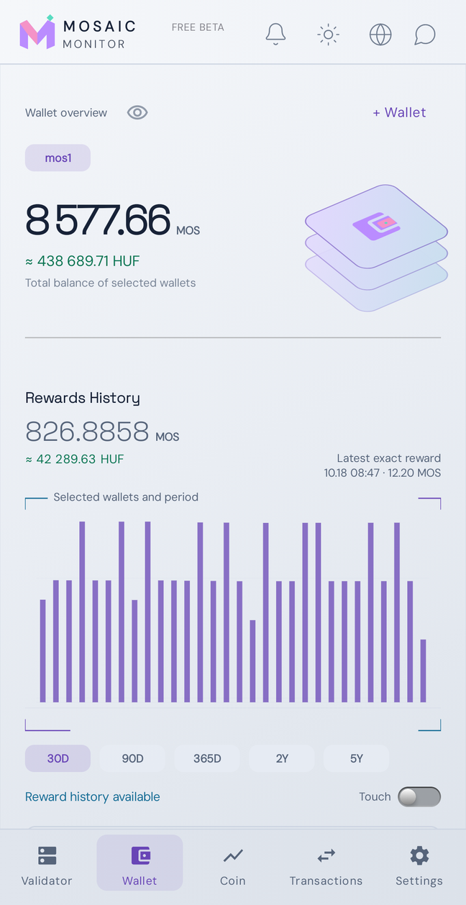

# Mosaic Monitor

**Your Mosaic Chain validators, wallets and market activity — together in one Android app.**

Check validators at a glance, follow sessions, manage nodes, explore rewards and keep track of MOS. A clean interface puts everyday monitoring within easy reach.

**[Visit the website and try the web validator explorer](https://app.mosaic-monitor.workers.dev)**

**[Follow Mosaic Monitor on X](https://x.com/MosaicMonitorHU)** — Project news, updates and short app demos.

App overview, videos and browser-based validator search with staking details. Registration is required to use the web explorer. Available on desktop and mobile.

**[Download the latest APK](https://github.com/Rolandinfo-ui/mosaic-monitor-releases/releases/latest)** · **[User guide](docs/USER_GUIDE.md)** · **[Screenshot gallery](docs/SCREENSHOTS.md)** · **[Telegram community](https://t.me/validalas_kerdesek)**

Android **8.0 or newer** · **English and Hungarian** · **Dark and light themes**

## Watch the app overview

See Mosaic Monitor in action in these short video tours.

| English narration | Hungarian narration |
| :---: | :---: |
|  |  |
| [Watch in English](https://www.youtube.com/shorts/MOYoegUaW2w) | [Watch in Hungarian](https://www.youtube.com/shorts/AHZY37EvDd8) |

Both videos show the app in use. The English overview has English narration and an English app interface; the Hungarian overview has Hungarian narration and a Hungarian app interface. Videos open on YouTube.

### Validator explorer and staking details

**[Watch the 20-second demo](https://www.youtube.com/shorts/35ntjP4OTlQ)** — Hungarian captions, music, no narration.

See the magnifier shortcut, search and Top 50, horizontal scrolling to scores, favourites, staking summaries, the composition chart and wallet contributions.

## Join the community

**[Mosaic Validator & Monitor on Telegram](https://t.me/validalas_kerdesek)**

Join the community for validator discussions, Mosaic Monitor updates, bug reports and feature ideas. The group is primarily Hungarian.

## A quick look

| Validator monitoring | Wallets and rewards |
| :---: | :---: |
|  |  |

## What you can do

- **Manage multiple validators:** status, blocks, current and next sessions, quick add/edit/remove actions, expandable query responses, automatic/manual gateways and an editable target node.
- **Reach node controls quickly:** Validator Login, Restart, Chill and Unchill where supported. A built-in authenticator can supply your saved TOTP code.
- **Follow several wallets together:** combine balances and reward charts, or inspect individual addresses, staking terms and vesting schedules.
- **Understand your rewards:** select wallets and periods, inspect daily rewards and fiat estimates, and open the detailed reward event list.
- **Stay informed while the screen is off:** background alerts report status changes and persistent indexer problems. The running phone monitor also reports session membership changes. Notification categories, sound and quiet hours are configurable.
- **Explore MOS price charts:** switch periods and save or share the selected chart as a PNG image.
- **Investigate transactions:** filter buys, sells and liquidity changes, inspect transaction and affected-wallet details, and export loaded results as CSV, PDF or TXT.
- **Stay connected:** community chat, developer-created polls, announcements and developer contact.
- **Read Mosaic resources:** open Blog, Status and Onboarding from the globe button, with built-in Hungarian translation for supported text.
- **Update conveniently:** find releases, download them and open the Android installer directly from the app.

## English or Hungarian, light or dark

The main interface supports **English and Hungarian**, with both light and dark themes. Screenshots here use English. Blog, Status and Onboarding also offer a Hungarian reading option. See the [paired gallery](docs/SCREENSHOTS.md).

## Download and update

Open **Releases** on this repository and download the APK attached to the latest published release. APK files are attached to releases; they are not stored in the source file list.

Android may ask you to allow installation from your browser. Confirm the installation to install or update Mosaic Monitor.

Install public updates over the existing public app to keep locally saved settings, validators and wallets. The app's **Version and updates** page can find a new release for you.

> Moving from an old internal test installation? Remove that test app once before installing the public version, then register again. This clears its local configuration; SubWallet and blockchain balances are unaffected. Normal updates between public versions do not require this step.

Minimum supported Android version: **Android 8.0**.

## Release information

Each release includes its version number, changes and APK. Read **What's new** in the app or on the release page before updating.

Beta releases are test versions. Please report problems through the developer contact and diagnostic log tools in the app.

## Feedback

Use the developer contact inside Mosaic Monitor for questions, problems or suggestions. Include the app version and the steps involved. A diagnostic report can be shared with the developer when needed.

Features continue to develop. Available access periods and package allowances are shown in the app; follow its current information when registering or renewing.
