# Mosaic Monitor — User Guide

[Home](../README.md) · [Download](https://github.com/Rolandinfo-ui/mosaic-monitor-releases/releases/latest) · [Screenshots](SCREENSHOTS.md)

Mosaic Monitor brings Mosaic Chain validator monitoring, node controls, wallets, rewards, market charts and transactions into one Android app. This guide describes version **1.0.24**. Data and available actions depend on your validator, wallet, connection and access allowance.

The screenshots use **English**. The main app also supports **Hungarian**, **dark mode** and **light mode**. This guide focuses on everyday use rather than a tour of the Settings menu.

## Contents

1. [Install and register](#install-and-register)
2. [Navigation](#navigation)
3. [Validators and sessions](#validators-and-sessions)
4. [Login, authenticator and node controls](#login-authenticator-and-node-controls)
5. [Gateways and query details](#gateways-and-query-details)
6. [Wallets and balances](#wallets-and-balances)
7. [Staking and vesting](#staking-and-vesting)
8. [Reward history](#reward-history)
9. [Price charts and image sharing](#price-charts-and-image-sharing)
10. [Transactions and exports](#transactions-and-exports)
11. [Notifications](#notifications)
12. [Community chat and polls](#community-chat-and-polls)
13. [Blog, Status and Onboarding](#blog-status-and-onboarding)
14. [Access information](#access-information)
15. [Updates](#updates)
16. [Help and feedback](#help-and-feedback)

## Install and register

You need **Android 8.0 or later**, an internet connection and the details of the Mosaic validator you want to monitor.

1. Open the [latest release](https://github.com/Rolandinfo-ui/mosaic-monitor-releases/releases/latest).
2. Under **Assets**, download the file ending in **.apk**. The automatic source archive links are not Android installers.
3. Open the downloaded file. Allow installation from your browser if Android asks, then confirm installation.
4. Open **Mosaic Monitor** and follow the registration prompt.
5. Enter your validator name and its wallet address. Give the wallet a recognizable name; if empty, the validator name is used. Use the SS58 or HEX field as appropriate and check the converted address.
6. Save and allow the initial checks to finish. Your validator appears on the Validator page.

Registration requires a valid validator/wallet combination. If it fails, check the name, address and connection. Current allowances determine how many validators and additional watch wallets you can add. The app indicates when activation or access needs attention.

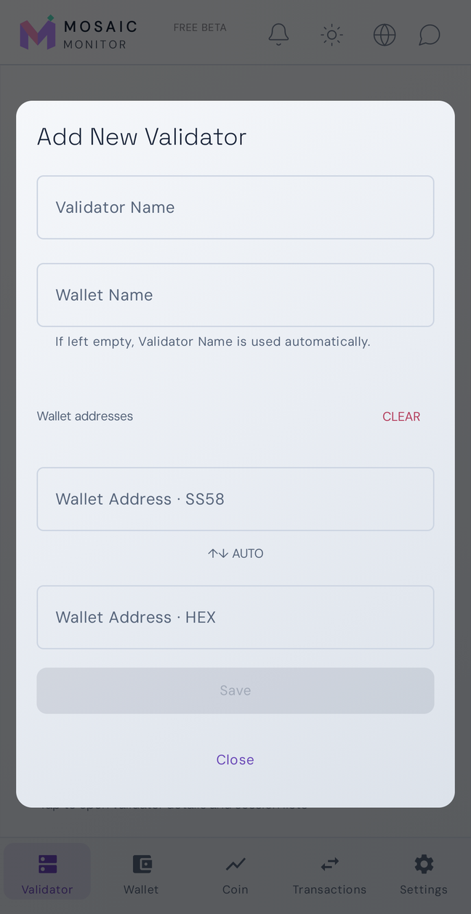

## Navigation

Use the bottom navigation for **Validator**, **Wallet**, **Coin** and **Transactions**. Each page starts with an overview; scroll for more sections and tap cards or rows for details.

| Top-bar control | Purpose |
| --- | --- |
| Bell | Developer messages and notification history |
| Theme button | Switch dark/light appearance |
| Globe | Blog, Status and Onboarding |
| Chat bubble | Shared community chat and an available poll |

Unread markers draw attention to new items. The chat marker clears when you open the chat. Language, fiat currency and notifications can be personalized in the app.

## Validators and sessions

The Validator page shows the selected validator's name, reported status, block information and current/next session panels. With multiple validators, select the one you want to inspect.

- **Current session:** number, membership, progress and estimated remaining time.
- **Next session:** upcoming session and whether the validator is selected.
- Tap the session area to open the corresponding member list.
- Open the validator details to inspect additional monitoring information.
- Scroll down for the validator network overview and query information.

Use **+ Validator** to add another entry. **Edit** changes the selected entry and its associated wallet details; its delete action removes the entry after confirmation. Deleting the last validator signs you out of the local registration flow. Removing a watched entry does not shut down the actual validator node.

## Login, authenticator and node controls

Tap **Validator Login**, enter the validator login details and required authenticator code, then choose **Login**. Once saved details and automatic TOTP are configured, returning to the controls is a short flow: open the login dialog and confirm login.

The built-in authenticator recognizes supported authenticator input, shows the decoded account and can save a TOTP account for that validator. Enable automatic code use if desired, and verify that the saved account belongs to the selected validator. Never share an authenticator secret, password or live code in a public screenshot.

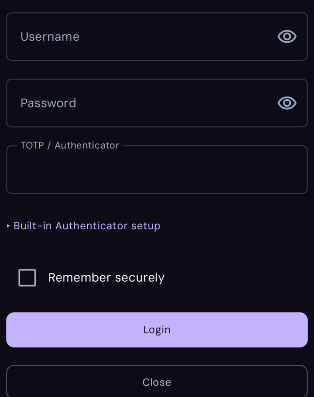 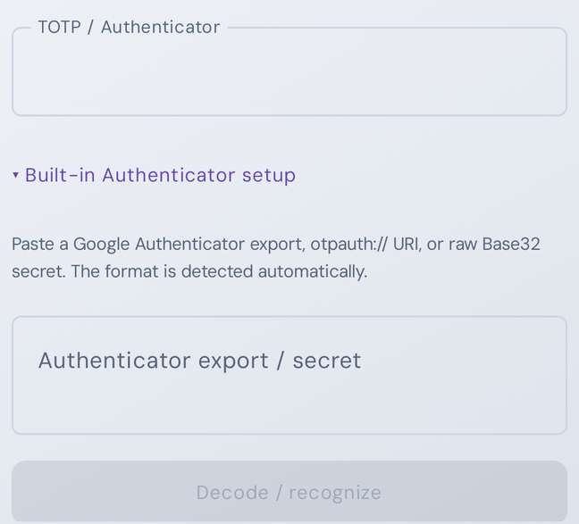

For supported imports, expand **Built-in Authenticator setup**, enter your authenticator export/URI or Base32 input, and choose **Decode / recognize**. Check the recognized account before saving it. Enable **Automatic TOTP fill** for subsequent logins if desired. The examples above deliberately show empty fields; use your own authenticator information only on your device.

After login, **Node management** offers the available controls:

| Item | Purpose |
| --- | --- |
| Status, block and peers | Reported node operating state |
| CPU, RAM and disk | Available system information |
| Refresh system information | Request a fresh system view |
| Restart node | Restart after confirmation |
| Chill | Pause/chill the validator where supported |
| Unchill | Request reactivation where supported |
| Logout from validator | End that management session |

These commands affect the actual validator. Check the selected node and read the confirmation. An accepted command may take time to complete; follow the reported state. Available actions depend on the validator and its current state.

## Gateways and query details

Expand the Validator page's query/response sections to inspect the latest monitoring results. They provide more detail than the overview alone.

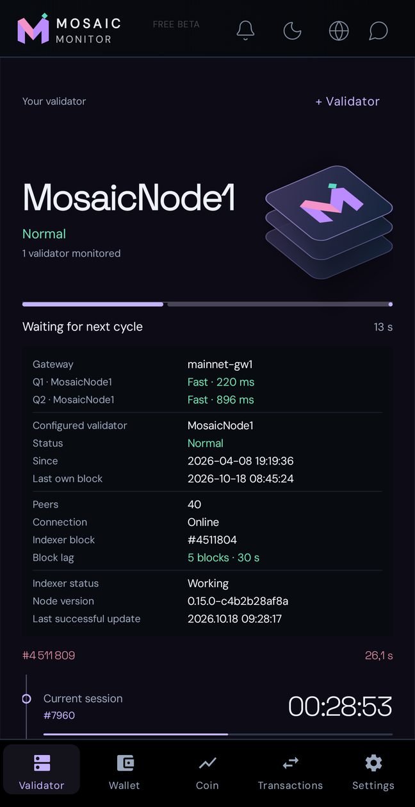

The gateway selector supports **automatic** selection and **manual** choice. You can also change the target node where its field is offered. After changing a connection, allow the next request to finish.

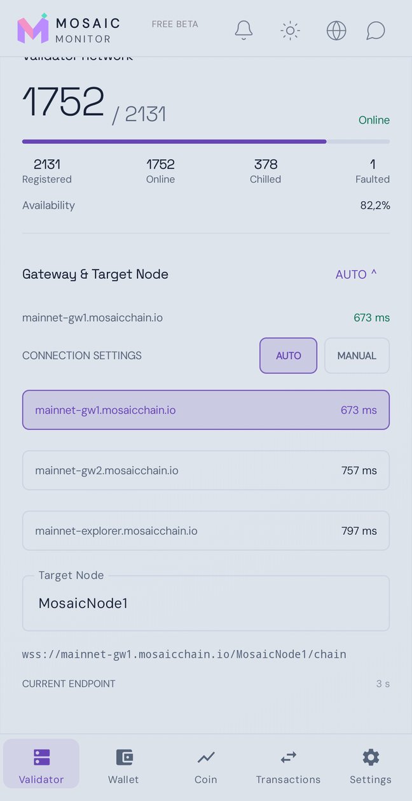

An indexer warning can indicate a failed/missing response, invalid reported values or excessive block lag. Validator status and indexer condition describe different aspects of operation; inspect both when diagnosing a problem.

## Wallets and balances

Open **Wallet** for the selected wallets' balance and reward overview.

1. Tap wallet-name buttons to include or exclude wallets. At least one stays selected.
2. Select several wallets to combine their balance and reward view.
3. Use the balance visibility control to hide amounts when needed.
4. Use **+ Wallet** to add an additional watch wallet within your allowance.

Scroll to **Wallet registry**. Each card shows **Free / Frozen**, **Total** and an approximate fiat value. Tap a card for addresses, balances, staking and vesting. Copy SS58 or HEX addresses from the detail view.

Standalone watch wallets can be edited or removed through their detail actions. A wallet marked **Managed by Validator** is managed through its corresponding validator entry.

The framed registry **Summary** covers all listed wallets, regardless of overview selection. The separate **Wallet Connection** area is distinct from adding a watch address: monitoring an address does not require connecting a wallet for payment.

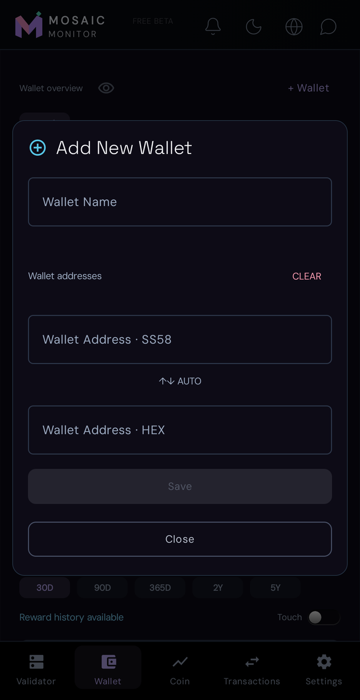

## Staking and vesting

Wallet details separate balances, **Staking** and **Vesting**, leaving the main cards compact.

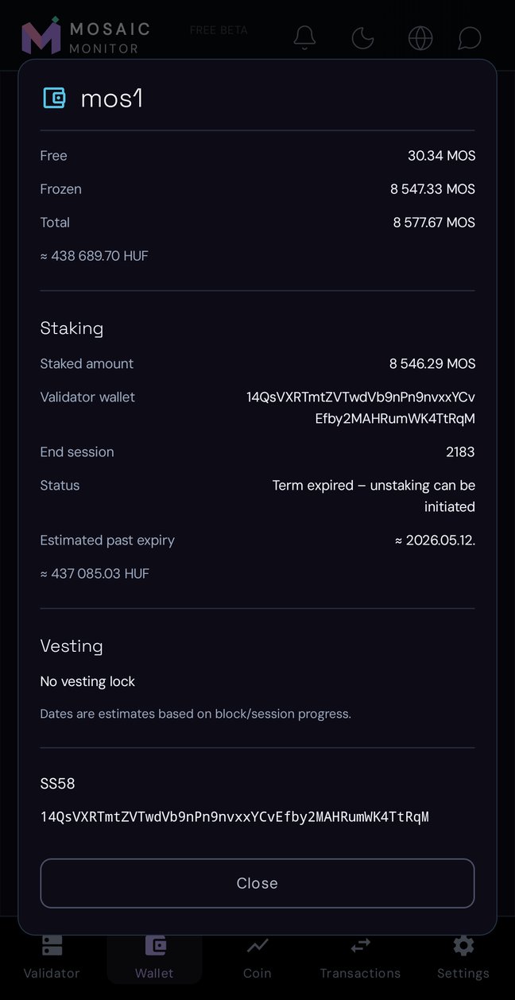

- **Total** is the wallet total. Staking and vesting describe uses or restrictions of that balance; do not add them to Total again.
- **Free / Frozen** show the reported balance categories. Check vesting restrictions too rather than assuming every Free amount is immediately transferable.
- **Staking** shows the staked amount, target validator address where available, end session, term status and approximate fiat value.
- **Vesting**, when present, shows available schedule details: remaining locked amount, releaseable amount, original schedule amount, remaining blocks/time and estimated completion. Otherwise, the dialog indicates **No vesting lock**.

**An expired term means unstaking/release can be initiated, not that funds have automatically become spendable.** Required unstaking and vesting-release actions must be completed in the appropriate wallet. Mosaic Monitor reads and displays this state.

Dates are estimates based on block/session progress. Lock categories may overlap. Read the Summary labels instead of summing every line.

Detailed lock data refreshes when you visit Wallet and its cached information is old enough. The progress bar below the wallet cards indicates a running refresh. Previously loaded values stay visible, and a refresh already started can finish after you move to another page.

## Reward history

1. Select one or several wallet-name buttons.
2. Choose **30D**, **90D**, **365D**, **2Y** or **5Y**. Available data determines the actual history shown.
3. Read the reward total for the selected wallets and period, with its approximate fiat value.
4. Enable **Touch** to inspect daily values by sliding over the chart. The daily reward and fiat estimate follow the selected day; enabling Touch initially shows the latest available day.
5. Disable Touch to return the right-hand readout to the **latest exact reward event**, with date/time. This is different from the whole-day sum.
6. Open **Reward event list** for individual entries in the selected period.

Wallet selection updates the view from available cached data; missing data may still need to load. Fiat uses the chosen currency and available conversion rate. It is an estimate, not a guaranteed sale value or a day-by-day historical exchange-rate valuation.

## Price charts and image sharing

Open **Coin** for MOS/USDC price, period changes, chart history and further market/liquidity information below.

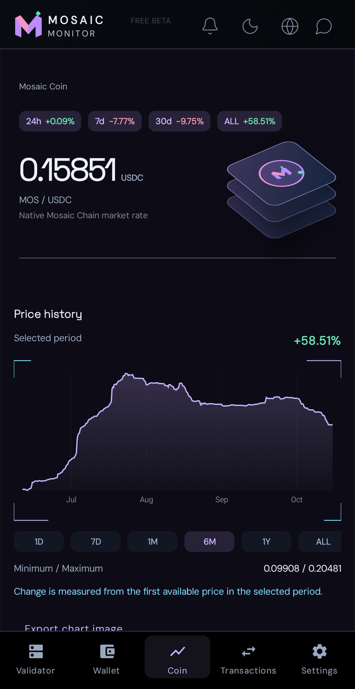

Choose **1D**, **7D**, **1M**, **6M**, **1Y** or **ALL**. Minimum/maximum and change summarize the selected period; change is measured from its first available price.

To export a picture:

1. Select your period and tap **Export chart image**.
2. Check the preview, period label and values.
3. Choose **Save PNG** to save a picture or **Share** for Android sharing.
4. Select the destination app or contact and complete the action. Opening Share alone sends nothing.

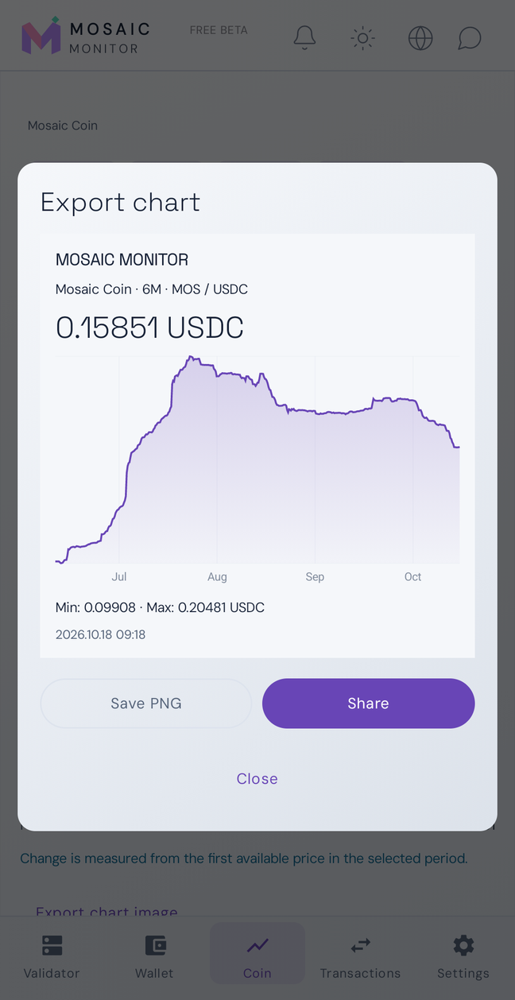

## Transactions and exports

**Transactions** lists available **BUY**, **SELL**, **liquidity added** and **liquidity removed** activity. Additions use blue accents and removals yellow, separate from buy/sell colours.

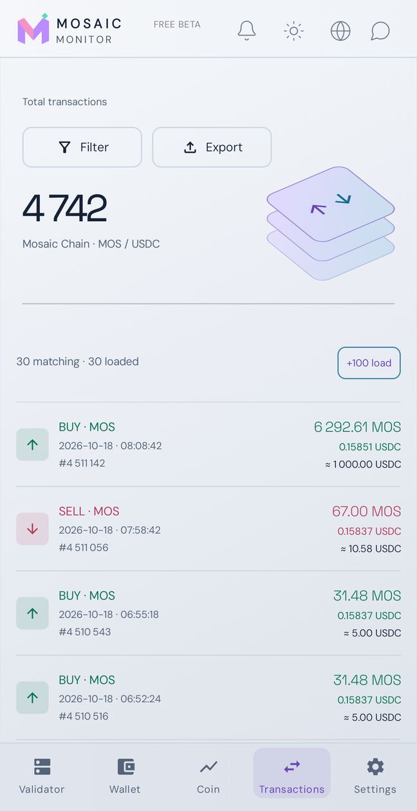

### Browse and filter

Use **Filter** to combine available type, date/time, block, price and amount criteria; amounts can be expressed in MOS or USDC. Apply filters to narrow the list or clear them to return to a broader view.

Use load-more controls or **Load all transaction history** for earlier entries. Version 1.0.24's configured history starts on **16 June 2026**; earlier dates are not offered. Large requests can take time. Loaded and matching counts distinguish fetched history from current filter results.

### Transaction details

Tap a row for type, date/time, MOS/USDC amounts, price, block and hash. The **Affected wallet** section requests additional information when you open it.

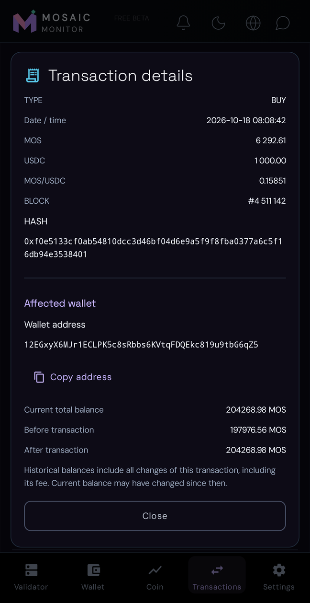

When resolved, you can copy the wallet address and inspect current total balance and available before/after balances. An address does not identify a person's name. Historical values include changes in that transaction, including its fee; the current balance may have changed since then. Ambiguous wallets or unavailable historical values are reported rather than guessed.

### Export

Tap **Export**, choose **CSV**, **PDF** or **TXT**, and select filtered results or all currently loaded rows. Choose the save location in Android's file picker. Load the desired history first: exporting does not automatically fetch every historical transaction.

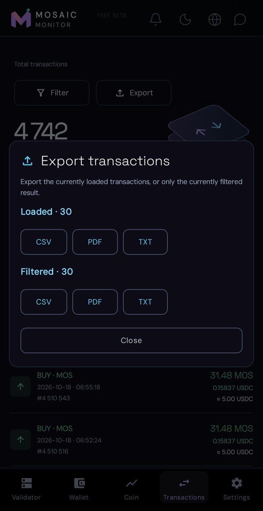

## Notifications

| Source | Behaviour |
| --- | --- |
| Background monitoring | Status-change and persistent indexer-error/recovery alerts can arrive with the screen off. You do not need to keep it awake. Internet access and Android notification permission are required. |
| Running phone monitor | Local status/indexer alerts and entry into or exit from the active session, based on the phone's monitoring results. This can react sooner while it runs. |

Background checks are **periodic, not instant**. The current interval is shown in the app. With a five-minute interval, two consecutive failed indexer checks can take roughly ten minutes to produce an alert, plus delivery time. Status changes are reported after the next check that detects them. Local alerts follow the phone's own monitoring cycle and thresholds.

Android can suspend local background work. Background alerts do not require continuously keeping the phone monitor awake. You may receive both a local and a background alert for the same event. Background monitoring applies while free, trial or paid access is valid.

Available categories include **status changes**, **indexer errors**, **session membership**, **developer messages** and **subscription reminders**. Sound and quiet hours can be customized; quiet hours silence alerts without changing the check frequency.

Open the **bell** for messages and the notification-history entry. History can be filtered by period, type and validator. Delete an entry or clear history without stopping monitoring. A red marker indicates unread items. The ongoing price/block notification is a separate status display, not an error alert.

## Community chat and polls

Tap the **chat bubble** for the shared room. This is a common conversation, not private messaging.

- Your messages, others' messages and developer messages have subtly different card colours.
- Names are short device-based identifiers.
- Type a message and tap **Send**. The layout makes room for the keyboard.
- A yellow icon marker indicates new messages until you open the chat.
- If posting is suspended, available messages remain readable but new ones cannot be sent.
- History is limited, so older messages may be removed. The developer can moderate the room.

A developer-created poll appears fixed above the conversation. **One poll is active at a time.** Select an option and submit with the vote button. Results appear after you vote; a submitted vote cannot be changed. Chat remains available below the poll.

## Blog, Status and Onboarding

Tap the **globe**, then choose **BLOG**, **STATUS** or **ONBOARDING** for Mosaic articles/news, status information or onboarding resources.

Choose **HU** for built-in Hungarian translation of supported English text, or **ORIGINAL** for the original. First use may require a download and a wait. Translation can be imperfect; embedded elements may stay in their original language. The reading frame follows the app theme, while external pages may keep their own colours. Close it to return to the app.

## Access information

The current offering may provide free access, a trial or an active subscription. The app shows the applicable state, dates and validator/wallet allowances. Follow the current in-app offer rather than example values in screenshots. This guide does not cover the Settings and activation menus in detail.

## Updates

1. Open **Version and updates** and tap **Check for updates**.
2. Read **What's new** when a newer release is available.
3. Tap **Download update** and wait for completion; a check/download can be cancelled.
4. Tap **Install update**, allow installation from Mosaic Monitor if requested, and confirm Android's installer.
5. Reopen the app.

Install public updates **over the existing public app** to retain local configuration. Normal updates do not require uninstalling. Release descriptions come from GitHub and currently appear in English even in the Hungarian interface. If no newer build is offered, the app reports that you have the latest version.

## Help and feedback

Contact the developer from the app. Include the app version, phone/Android model, page/action, expected versus actual result, approximate time and connection state. A screenshot or diagnostic report shared directly with the developer can help.

Do not publicly post passwords, authenticator secrets or recovery phrases. For stale data, check the connection and visible loading/error message. For missing alerts, check notification permission, categories and quiet hours.

[Back to top](#mosaic-monitor--user-guide) · [Home](../README.md) · [Download](https://github.com/Rolandinfo-ui/mosaic-monitor-releases/releases/latest)

